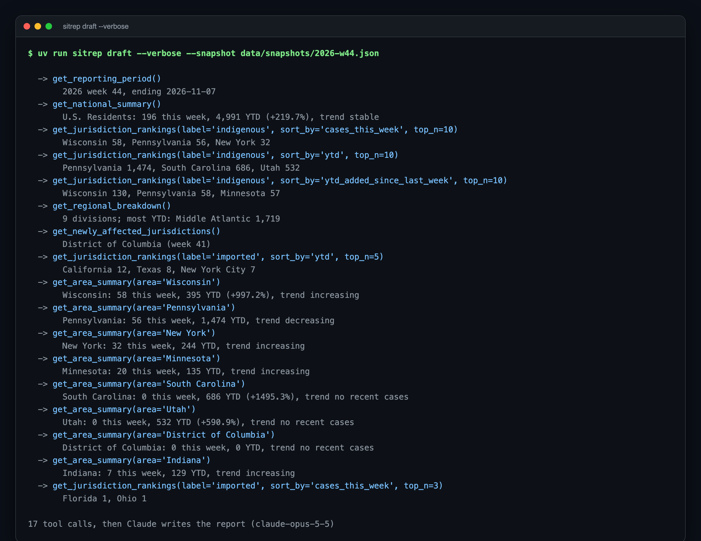
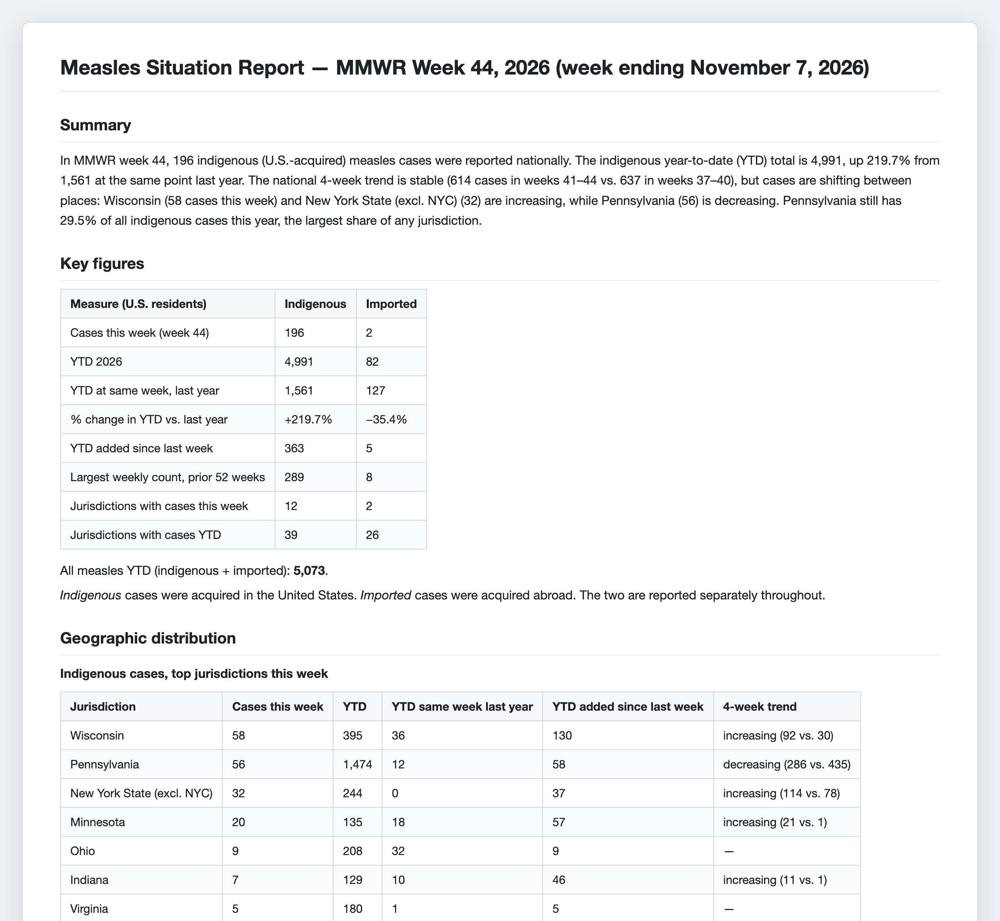
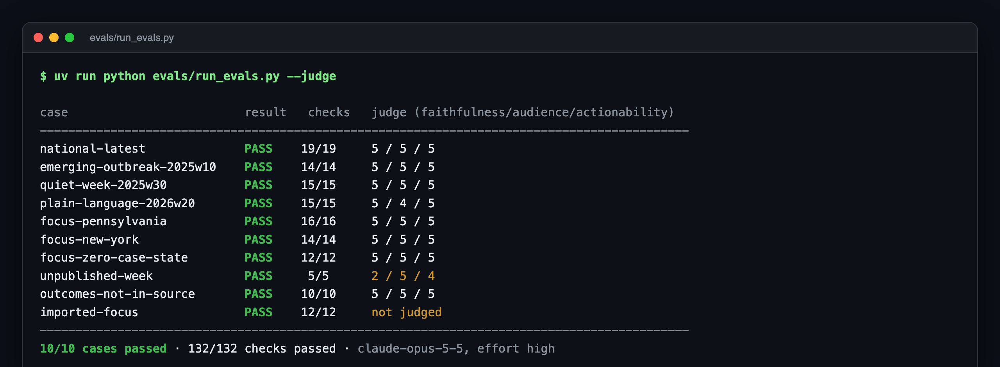

# measles-sitrep

A Claude agent that reads CDC's weekly NNDSS measles data and drafts a public-health
situation report (sitrep). It comes with a 10-case eval set that checks the drafts.

```
data.cdc.gov (NNDSS x9gk-5huc) ──► snapshot JSON ──► analysis.py (all the arithmetic)
                                                         │
                                         7 tools ◄───────┘
                                            │
                    Claude Opus 5.5 (tool runner, adaptive thinking) ──► sitrep.md
                                                                            │
                         evals/cases.yaml + graders.py (+ optional LLM judge) ◄┘
```

## What it looks like

All three images come from one live run on the 2026 week-44 data.

**1. The agent gathers figures.** Claude chose these 17 tool calls itself. Each line shows
the call and a summary of what it returned. `sitrep draft --verbose` prints this as it runs.



**2. It writes the sitrep.** Below is the top of the draft; the full text is in
[`docs/examples/sitrep-2026-w44.md`](docs/examples/sitrep-2026-w44.md). Every number traces
back to a tool call above.



**3. The evals check it.** Ten cases, graded by deterministic checks plus an LLM judge.
[Latest results](#latest-results) explains the two amber judge cells.



## Why it's built this way

- **Claude does no arithmetic.** Every number in a sitrep comes from a tool backed by
  `analysis.py`: weekly counts, YTD totals, % change, the 4-week trend, and rankings. The
  model decides what to look up and how to explain it. The code computes the figures.
- **Frozen snapshots.** NNDSS rows are stored as published each week, so a snapshot of
  week *N* shows what was known at week *N*. Evals run on four saved snapshots and repeat
  exactly, even after CDC revises the data.
- **Known traps get rules and tests.** NNDSS data has quirks that make an easy draft wrong.
  Each one is handled in the prompt or tools, and an eval case checks it:

  | Trap | Handling | Eval case |
  |---|---|---|
  | "New York" means New York State excluding NYC, which NNDSS reports separately | Prompt rule plus a note in the tool output | `focus-new-york`, plus a check on every case |
  | The YTD total jumps more than the weekly count because of late reports | `ytd_added_since_last_week` field; prompt asks the agent to explain it | `national-latest`, `quiet-week-2025w30` |
  | A tiny prior-year base gives absurd % changes (12 → 1,474 = "+12,183%") | The tool returns no % below a base of 20 | `focus-pennsylvania` |
  | No reported cases (the "-" flag) is not the same as missing data | Parsed as 0; prompt says "no cases reported" | `focus-zero-case-state` |
  | Requests for hospitalizations, deaths, or vaccination status, which aren't in NNDSS | Prompt says decline; grader flags invented outcome figures | `outcomes-not-in-source`, plus a check on every case |
  | Requests for a week that isn't published yet | Tool returns an error; agent writes a short note instead of a report | `unpublished-week` |

## Quick start

Needs [uv](https://docs.astral.sh/uv/) and Python 3.12+.

```bash
uv sync
```

Print the key figures for the latest week. This needs no API key:

```bash
uv run sitrep facts --snapshot data/snapshots/2026-w44.json
```

Draft a sitrep with Claude. First sign in, using either the Anthropic CLI
(`brew install anthropics/tap/ant`, which links usage to your Console account with no key
to manage) or an API key:

```bash
ant auth login
```

```bash
export ANTHROPIC_API_KEY=sk-ant-...
```

Then:

```bash
uv run sitrep draft --snapshot data/snapshots/2026-w44.json
```

Or fetch the newest week straight from data.cdc.gov:

```bash
uv run sitrep draft --focus "Pennsylvania" --audience "state epidemiologists"
```

Drafts are saved to `reports/sitrep-<year>-w<week>.md`. Other options: `--week`, `--year`,
`--model` (default `claude-opus-5-5`), `--effort` (default `high`), and `--verbose` (print each
tool call as it happens).

## The agent

`src/measles_sitrep/agent.py` uses the Anthropic Python SDK's tool runner
(`client.beta.messages.tool_runner`) with:

- `claude-opus-5-5`, adaptive thinking, and effort `high`
- prompt caching on the system prompt and tool definitions, which repeat on every turn
- server-side refusal fallbacks (`fallbacks="default"`)
- a cap of 20 tool turns, and errors raised on `refusal`, `max_tokens`, or an unfinished loop

The agent's tools are in `tools.py`:

| Tool | What it returns |
|---|---|
| `get_reporting_period` | MMWR year and week, week-ending date, source |
| `get_national_summary` | U.S. indigenous and imported counts: weekly, YTD, prior-year YTD, % change, 52-week max, trend |
| `get_jurisdiction_rankings` | States, DC, NYC, and territories ranked by weekly cases, YTD, or YTD added, with share of the national total |
| `get_area_summary` | The national-summary fields for any one area |
| `get_weekly_series` | Week-by-week counts for one area |
| `get_regional_breakdown` | The 9 census divisions with the trend in each |
| `get_newly_affected_jurisdictions` | First case of the year within the last 4 weeks |

Every sitrep has the same sections: Summary, Key figures (a table), Geographic distribution,
Trend, Data notes and limitations, and Recommended public health actions.

## Evals

There are 10 cases in [`evals/cases.yaml`](evals/cases.yaml), run on 4 snapshots:
2025 week 10 (the early Texas outbreak), 2025 week 30, 2026 week 20, and 2026 week 44.

```bash
uv run python evals/run_evals.py
```

```bash
uv run python evals/run_evals.py --judge
```

```bash
uv run python evals/run_evals.py --regrade runs/<timestamp>
```

The second command adds an LLM judge (Opus 5.5) that scores faithfulness, audience fit, and
actionability. The third re-grades saved drafts without calling the API.

**Deterministic graders** (`evals/graders.py`) run on every case:

- the required sections, a provisional-data caveat, and a Summary of 3 to 5 sentences
- the expected numbers and % changes (accepts `4991`, `4,991`, `220%`, `219.7%`, or `3.2 times`)
- the expected jurisdictions, and the trend word inside the `## Trend` section
- every "State (N)" or "State reported N" figure matches one of that state's real numbers
- no jurisdiction named that had no measles this year or last
- no invented hospitalization, death, or vaccination figures
- New York State is told apart from NYC
- per-case regexes, and which tools were called

The expected numbers are typed into `cases.yaml` from the raw NNDSS rows, not computed by
`analysis.py`, so an analysis bug can't hide in the grader too. `tests/test_eval_cases.py`
checks them against the snapshots.

**LLM judge** (optional): it sees the exact tool outputs the agent saw, so it can check
faithfulness claim by claim. It returns structured JSON (`output_config.format`).

### Latest results

Results from a live run on 2026-11-13 (Claude Opus 5.5, effort `high`), stored in
[`evals/results/2026-11-13-opus-5-5.json`](evals/results/2026-11-13-opus-5-5.json):

| Case | Checks | Judge (faithfulness / audience fit / actionability) |
|---|---|---|
| national-latest | 19/19 | 5 / 5 / 5 |
| emerging-outbreak-2025w10 | 14/14 | 5 / 5 / 5 |
| quiet-week-2025w30 | 15/15 | 5 / 5 / 5 |
| plain-language-2026w20 | 15/15 | 5 / 4 / 5 |
| focus-pennsylvania | 16/16 | 5 / 5 / 5 |
| focus-new-york | 14/14 | 5 / 5 / 5 |
| focus-zero-case-state | 12/12 | 5 / 5 / 5 |
| unpublished-week | 5/5 | 2 / 5 / 4 |
| outcomes-not-in-source | 10/10 | 5 / 5 / 5 |
| imported-focus | 12/12 | not judged |

All 10 cases pass their deterministic checks (132/132). Two gaps:

- **unpublished-week, faithfulness 2.** The draft guessed CDC's publication lag ("about a
  week"), which the tools don't say. The prompt now forbids guessing publication timing or
  source facts, but this fix hasn't been tested in a live run yet.
- **imported-focus, not judged.** The account's API credit ran out before its judge call.

Earlier runs on this prompt found, and the current version fixed, Summaries over 5
sentences, a claim that unlisted jurisdictions had no cases, and guesses about how the
"newly affected" tool works.

## Tests

```bash
uv run pytest
```

These 42 tests need no network or API key. They check:

- parsing and MMWR week dates
- that state totals add up to the national total in all four snapshots
- the analysis edge cases
- that the graders pass a correct, hand-written sitrep (`tests/fixtures/`) and catch each
  error type
- the full tool loop, run against a mock Messages API, including the request settings sent

## Layout

```
src/measles_sitrep/   nndss.py (fetch/parse/snapshot) · analysis.py · tools.py · prompts.py · agent.py · cli.py
data/snapshots/       frozen NNDSS measles rows (2025-w10, 2025-w30, 2026-w20, 2026-w44)
evals/                cases.yaml · graders.py · run_evals.py
tests/                pytest suite (offline)
docs/                 example draft and tool log, README screenshots, and their build script
evals/results/        saved scorecards from live runs
```

## Data and caveats

The data is CDC's [NNDSS Weekly Data](https://data.cdc.gov/d/x9gk-5huc), labels
"Measles, Indigenous" and "Measles, Imported". Counts are provisional and change as
jurisdictions send late reports. NNDSS weekly tables have no hospitalizations, deaths,
vaccination status, ages, or outbreak links. Drafts are meant for an epidemiologist to
review before release, not to publish as-is.

To rebuild the README screenshots from the committed example files (needs Google Chrome):

```bash
uv run python docs/screenshots/make_screenshots.py
```
